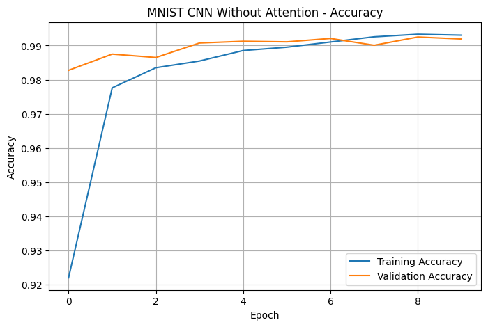
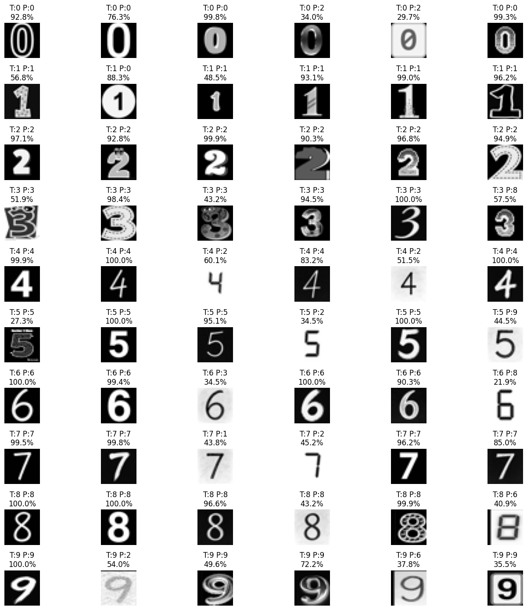

# Does Attention Help a Small CNN?

Image classifiers on MNIST, CIFAR-10, and CIFAR-100, each trained with and without an attention layer to see whether attention earns its place.

Individual coursework for CS190-4P, a third-year machine learning course at Mapúa Malayan Colleges Laguna, by Jherwin Indaya.

## Results

Accuracy on each dataset's official 10,000-image test set:

| Dataset | Without attention | With attention |
| --- | --- | --- |
| MNIST | **99.27%** | 99.13% |
| CIFAR-10 | **74.19%** | 73.42% |
| CIFAR-100 | **51.50%** | 51.45% |

**Finding:** attention did not help. The plain CNN matched or beat the attention version on all three datasets. At this size, the convolutions already capture what the attention layer adds.

Each model was also tried on a small set of outside images it had never seen, such as digits collected from the web: 60 images each for MNIST and CIFAR-10. On MNIST the plain CNN got 75% of them right, against 60% with attention; on CIFAR-10 both got 73%. The drop from 99% to 75% on MNIST shows how far real-world digits are from the clean, centred MNIST style.

| | |
| --- | --- |
|  |  |

## Method

- **One network per dataset, trained twice:** once as is, and once with a Keras scaled dot-product attention layer over the final feature map, joined back to the original features.
- **MNIST and CIFAR-10:** three convolution layers (32, 64, and 64 filters, each followed by max pooling), then dropout and a softmax layer.
- **CIFAR-100:** with ten times the classes, a deeper network of eight convolution layers (32 up to 256 filters) with batch normalization.
- **Training:** Adam, batch size 64, a 20% validation split, and seed 42.
- **Evaluation:** the official test set once per model, then the outside images, with precision, recall, F1, and a confusion matrix for each.

The summary cells at the end of each section reload the saved models, so a few CIFAR figures there differ slightly from the direct test evaluation used above.

## Repository contents

| Path | Contents |
| --- | --- |
| `notebooks/cnn_attention_mnist_cifar.ipynb` | All six models: training, test evaluation, and outside-image checks. Outputs are kept. |
| `figures/` | The MNIST training curve and outside-image predictions shown above. |

The outside test images and the trained models are not included.

## How to run

1. Open the notebook with the **Open in Colab** badge above and choose a GPU runtime (**Runtime → Change runtime type → T4 GPU**).
2. MNIST, CIFAR-10, and CIFAR-100 download automatically through Keras.
3. The outside-image cells expect your own images in Google Drive, in one folder per class, at the paths set in those cells. Skip them if you don't have any.

## License

The code and notebook are released under the [MIT License](LICENSE). The datasets keep their own terms.
